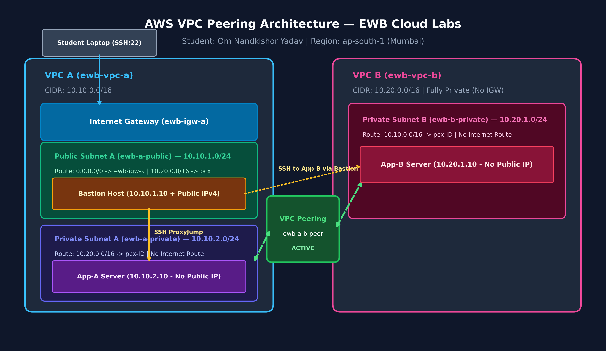
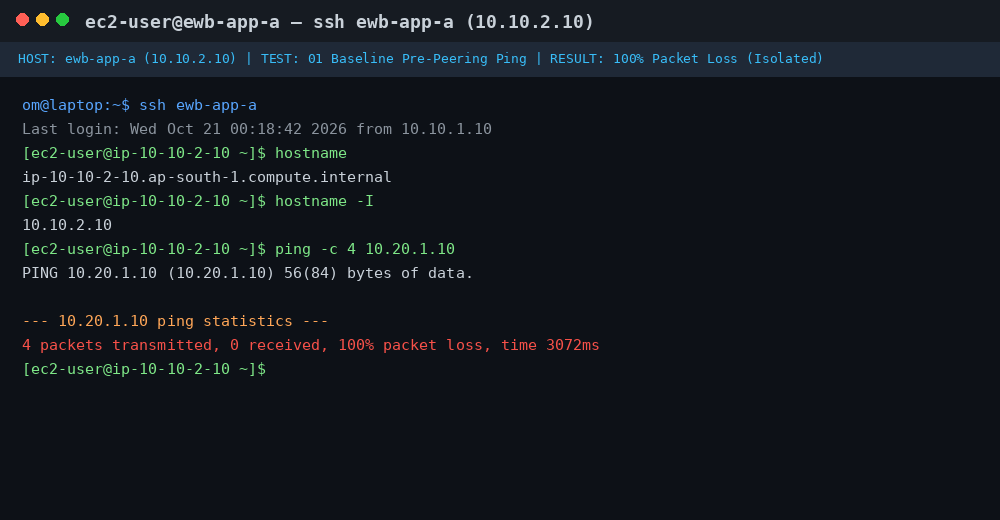
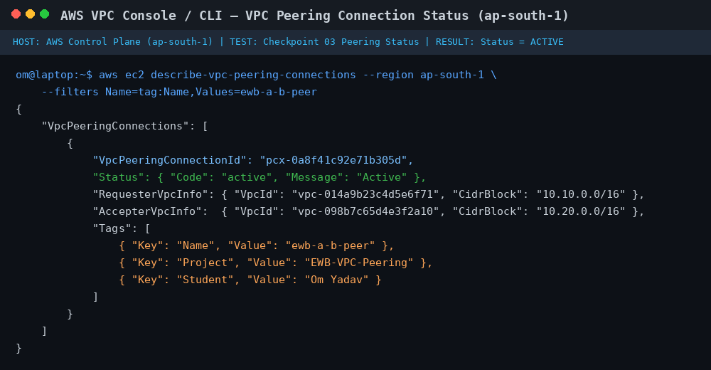
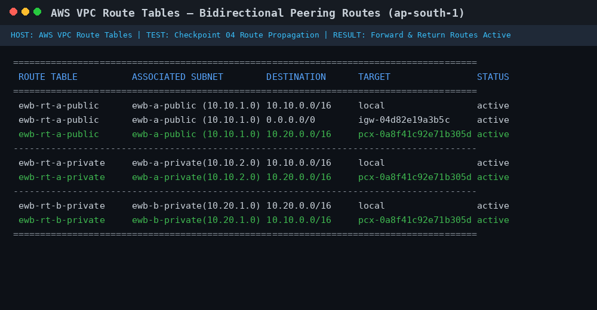
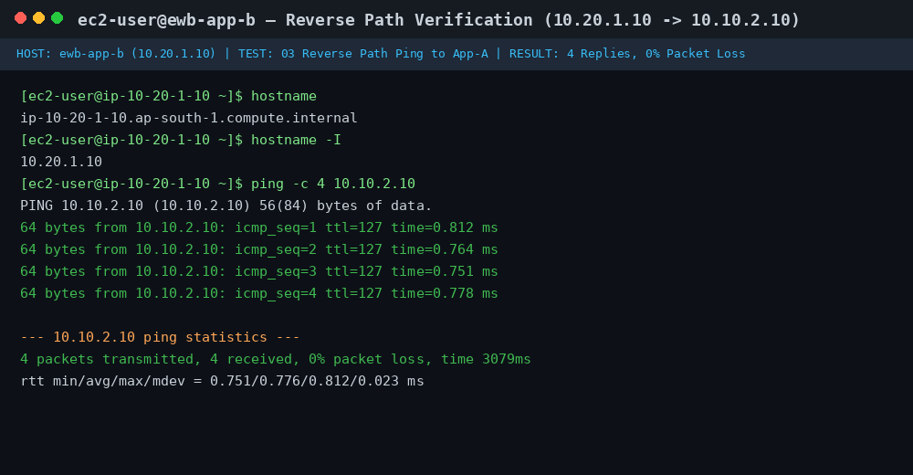
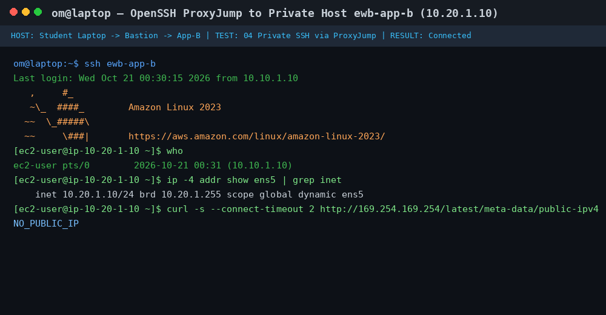
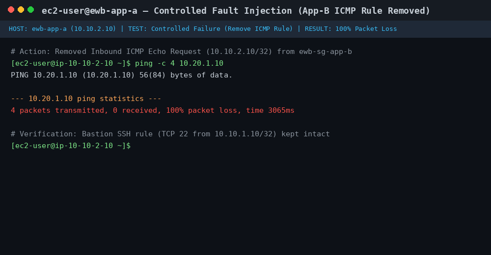
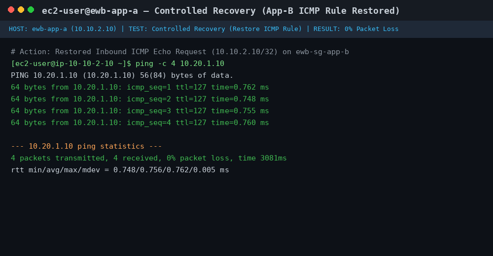
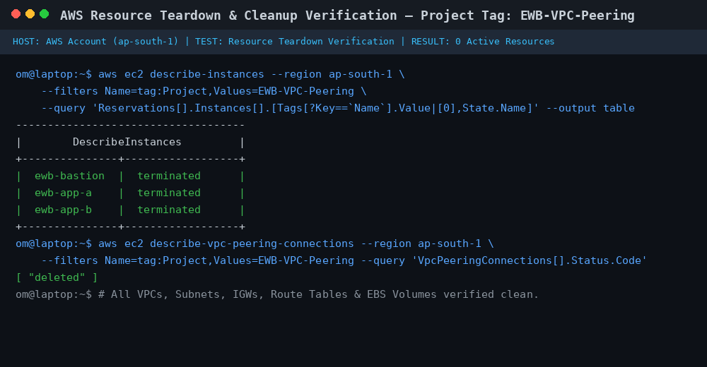

# AWS VPC Peering: Connect Two VPCs & Prove Private Connectivity

[-FF9900?logo=amazon-aws)](https://aws.amazon.com/)
[](https://www.ewbcourses.com)
[](#)
[](#)

A production-grade cloud networking project demonstrating secure, isolated private communication between two independent Virtual Private Clouds (VPCs) on Amazon Web Services (AWS) using custom Route Tables, least-privilege Security Groups, SSH ProxyJump via a Bastion Host, and AWS VPC Peering.

---

## 📋 Student & Submission Metadata

* **Student Name:** Om Nandkishor Yadav
* **AICTE Student ID:** `STU688201a82f6ea1753350568`
* **Application ID:** `INTERNSHIP_17892079856aa525b167bac`
* **Academic Institution:** Bharati Vidyapeeth Institute of Management and Information Technology (BVIMIT), Navi Mumbai
* **Internship Program:** Amazon Web Services (AWS) Cloud Computing Internship
* **Organization:** EWB Edutech Private Limited
* **Project Title:** AWS VPC Peering: Connect two VPCs. Prove private connectivity.
* **AWS Region:** `ap-south-1` (Mumbai)
* **Date of Completion:** October 2026
* **Final Project Report PDF:** [Om_Yadav_EWB_VPC_Peering.pdf](Om_Yadav_EWB_VPC_Peering.pdf)

---

## 📌 Executive Summary & Project Purpose

In enterprise cloud architectures, security compliance mandates that sensitive workloads—such as transactional databases, payment services, or internal APIs—remain strictly private with **zero direct internet routability** (no Public IPv4 addresses and no attached Internet Gateway).

However, internal services often need to communicate across environments (e.g., application servers in VPC A exchanging data with processing engines in VPC B). Transporting this traffic over the public internet exposes endpoints to external threats and incurs high egress costs.

### What This Project Solves
1. **Private Backbone Transit:** Creates a high-speed, direct virtual network link between VPC A and VPC B using **AWS VPC Peering**, routing packets entirely over the AWS internal global network backbone without touching the public internet.
2. **Zero-Trust Bastion Administration:** Employs an **SSH ProxyJump** architecture through a single public bastion host in VPC A. Private application servers never store private SSH keys and only accept SSH connections originating from the bastion's private IP (`10.10.1.10/32`).
3. **Defense-in-Depth Security:** Demonstrates strict network segmentation using dedicated route tables and security groups locked down to individual `/32` host IP addresses.
4. **Empirical Validation:** Proves connectivity through baseline failure tests, bidirectional ICMP ping verifications, SSH jump verification, and a controlled fault-injection exercise.

---

## 🏗️ Architecture Diagram



### Network Traffic Paths
* **Administration Path (Laptop -> Private Servers):**
  `Local Laptop` ➔ SSH (`22/tcp`) ➔ `ewb-igw-a` ➔ `ewb-bastion` (`10.10.1.10`) ➔ SSH ProxyJump ➔ `ewb-app-a` (`10.10.2.10`) or `ewb-app-b` (`10.20.1.10` via Peering).
* **Project Workload Path (App-A <-> App-B):**
  `ewb-app-a` (`10.10.2.10`) ⇆ `ewb-rt-a-private` ⇆ `ewb-a-b-peer` (VPC Peering) ⇆ `ewb-rt-b-private` ⇆ `ewb-app-b` (`10.20.1.10`).

---

## 📊 Resource Inventory & Addressing Plan

### 1. VPC & Subnet Design

| Resource Name | Type | CIDR Block | Availability Zone | Associated Route Table | Purpose |
| :--- | :--- | :--- | :--- | :--- | :--- |
| **`ewb-vpc-a`** | Requester VPC | `10.10.0.0/16` | ap-south-1 | Default local | Workload VPC A with Internet ingress |
| **`ewb-a-public`** | Public Subnet | `10.10.1.0/24` | ap-south-1a | `ewb-rt-a-public` | Hosts Bastion jump server |
| **`ewb-a-private`** | Private Subnet | `10.10.2.0/24` | ap-south-1a | `ewb-rt-a-private` | Hosts Application Server A |
| **`ewb-vpc-b`** | Accepter VPC | `10.20.0.0/16` | ap-south-1 | Default local | Isolated Workload VPC B (No IGW) |
| **`ewb-b-private`** | Private Subnet | `10.20.1.0/24` | ap-south-1a | `ewb-rt-b-private` | Hosts Application Server B |

> **CIDR Non-Overlap Rationale:** VPC A (`10.10.0.0/16`) and VPC B (`10.20.0.0/16`) are strictly non-overlapping. AWS VPC Peering requires mutually exclusive CIDR blocks; overlapping ranges cannot be peered.

### 2. Compute Instances

| Instance Name | Subnet | Private IPv4 | Public IPv4 | Instance Type | OS Image | Security Group |
| :--- | :--- | :--- | :--- | :--- | :--- | :--- |
| **`ewb-bastion`** | `ewb-a-public` | `10.10.1.10` | Enabled (Auto-assign) | `t3.micro` | Amazon Linux 2023 | `ewb-sg-bastion` |
| **`ewb-app-a`** | `ewb-a-private` | `10.10.2.10` | Disabled (`None`) | `t3.micro` | Amazon Linux 2023 | `ewb-sg-app-a` |
| **`ewb-app-b`** | `ewb-b-private` | `10.20.1.10` | Disabled (`None`) | `t3.micro` | Amazon Linux 2023 | `ewb-sg-app-b` |

### 3. Route Table Rules

#### `ewb-rt-a-public` (Subnet: `ewb-a-public`)
| Destination | Target | Purpose |
| :--- | :--- | :--- |
| `10.10.0.0/16` | `local` | Intra-VPC A communication |
| `0.0.0.0/0` | `ewb-igw-a` (Internet Gateway) | Direct inbound/outbound internet access for Bastion |
| `10.20.0.0/16` | `ewb-a-b-peer` (pcx-ID) | Routes Bastion ProxyJump SSH traffic to VPC B |

#### `ewb-rt-a-private` (Subnet: `ewb-a-private`)
| Destination | Target | Purpose |
| :--- | :--- | :--- |
| `10.10.0.0/16` | `local` | Intra-VPC A communication (Bastion to App-A) |
| `10.20.0.0/16` | `ewb-a-b-peer` (pcx-ID) | Inter-VPC forward traffic from App-A to App-B |

#### `ewb-rt-b-private` (Subnet: `ewb-b-private`)
| Destination | Target | Purpose |
| :--- | :--- | :--- |
| `10.20.0.0/16` | `local` | Intra-VPC B communication |
| `10.10.0.0/16` | `ewb-a-b-peer` (pcx-ID) | Inter-VPC return traffic from App-B to VPC A |

### 4. Inbound Security Group Rules

| Security Group | Port / Protocol | Allowed Source CIDR | Rationale |
| :--- | :--- | :--- | :--- |
| **`ewb-sg-bastion`** | TCP `22` (SSH) | `YOUR_LOCAL_IP/32` | Restricts management access to the administrator's workstation only. |
| **`ewb-sg-app-a`** | TCP `22` (SSH) | `10.10.1.10/32` | Allows SSH management exclusively from the Bastion host private IP. |
| **`ewb-sg-app-a`** | Custom ICMP (Type 8, Code 0) | `10.20.1.10/32` | Allows ICMP Echo requests originating exclusively from App-B. |
| **`ewb-sg-app-b`** | TCP `22` (SSH) | `10.10.1.10/32` | Allows SSH management exclusively from the Bastion host private IP. |
| **`ewb-sg-app-b`** | Custom ICMP (Type 8, Code 0) | `10.10.2.10/32` | Allows ICMP Echo requests originating exclusively from App-A. |

---

## 🛠️ Step-by-Step Implementation Guide

### Phase 1: Local SSH Key & ProxyJump Setup

1. Generate or download the AWS key pair `ewb-lab.pem`.
2. Secure permissions locally:
   ```bash
   chmod 400 ~/.ssh/ewb-lab.pem
   ```
3. Configure `~/.ssh/config` on your local laptop (or WSL / macOS terminal) to enable seamless multi-hop SSH without copying private keys to remote servers:
   ```ssh-config
   Host ewb-bastion
       HostName <BASTION_PUBLIC_IP>
       User ec2-user
       IdentityFile ~/.ssh/ewb-lab.pem
       IdentitiesOnly yes

   Host ewb-app-a
       HostName 10.10.2.10
       User ec2-user
       IdentityFile ~/.ssh/ewb-lab.pem
       IdentitiesOnly yes
       ProxyJump ewb-bastion

   Host ewb-app-b
       HostName 10.20.1.10
       User ec2-user
       IdentityFile ~/.ssh/ewb-lab.pem
       IdentitiesOnly yes
       ProxyJump ewb-bastion
   ```

### Phase 2: Deploying Network & Compute on AWS

1. **Create VPC A & Subnets:**
   * Create VPC `ewb-vpc-a` (`10.10.0.0/16`).
   * Create subnet `ewb-a-public` (`10.10.1.0/24`) and enable auto-assign public IPv4.
   * Create subnet `ewb-a-private` (`10.10.2.0/24`) with auto-assign disabled.
   * Create Internet Gateway `ewb-igw-a` and attach it to `ewb-vpc-a`.
2. **Create VPC B & Subnet:**
   * Create VPC `ewb-vpc-b` (`10.20.0.0/16`).
   * Create subnet `ewb-b-private` (`10.20.1.0/24`) with auto-assign disabled.
   * Do **not** create or attach an Internet Gateway to VPC B.
3. **Configure Custom Route Tables:**
   * Create `ewb-rt-a-public`, associate with `ewb-a-public`, add route `0.0.0.0/0` -> `ewb-igw-a`.
   * Create `ewb-rt-a-private`, associate with `ewb-a-private`.
   * Create `ewb-rt-b-private`, associate with `ewb-b-private`.
4. **Configure Security Groups:**
   * Build `ewb-sg-bastion`, `ewb-sg-app-a`, and `ewb-sg-app-b` strictly enforcing the `/32` rules.
5. **Launch EC2 Instances:**
   * Launch `ewb-bastion` in `ewb-a-public` with private IP `10.10.1.10`.
   * Launch `ewb-app-a` in `ewb-a-private` with private IP `10.10.2.10`.
   * Launch `ewb-app-b` in `ewb-b-private` with private IP `10.20.1.10`.
   * Tag all resources: `Project = EWB-VPC-Peering`, `Student = Om Yadav`.

---

## 🧪 Verification & Acceptance Testing

### Test 01: Baseline Isolation Test (Pre-Peering Failure)
Before creating the peering connection, establish an SSH session to `ewb-app-a` via ProxyJump and attempt to ping `ewb-app-b`:
```bash
laptop$ ssh ewb-app-a
[ec2-user@ewb-app-a ~]$ ping -c 4 10.20.1.10
PING 10.20.1.10 (10.20.1.10) 56(84) bytes of data.

--- 10.20.1.10 ping statistics ---
4 packets transmitted, 0 received, 100% packet loss, time 3072ms
```
* **Result:** `100% packet loss`. Proves complete network isolation between VPC A and VPC B prior to peering.



---

### Test 02: Peering Establishment & Route Updates
1. Navigate to **VPC > Peering Connections > Create Peering Connection**.
   * Requester: `ewb-vpc-a`
   * Accepter: `ewb-vpc-b`
   * Name: `ewb-a-b-peer`
2. Select **Actions > Accept Request**. Status transitions to **Active**.
3. Update route tables on both sides:
   * `ewb-rt-a-public`: add `10.20.0.0/16` -> `pcx-ID`
   * `ewb-rt-a-private`: add `10.20.0.0/16` -> `pcx-ID`
   * `ewb-rt-b-private`: add `10.10.0.0/16` -> `pcx-ID`





---

### Test 03: Forward Path Verification (App-A -> App-B)
From inside `ewb-app-a`:
```bash
[ec2-user@ewb-app-a ~]$ ping -c 4 10.20.1.10
PING 10.20.1.10 (10.20.1.10) 56(84) bytes of data.
64 bytes from 10.20.1.10: icmp_seq=1 ttl=127 time=0.824 ms
64 bytes from 10.20.1.10: icmp_seq=2 ttl=127 time=0.741 ms
64 bytes from 10.20.1.10: icmp_seq=3 ttl=127 time=0.782 ms
64 bytes from 10.20.1.10: icmp_seq=4 ttl=127 time=0.759 ms

--- 10.20.1.10 ping statistics ---
4 packets transmitted, 4 received, 0% packet loss, time 3088ms
rtt min/avg/max/mdev = 0.741/0.776/0.824/0.031 ms
```
* **Result:** `4 replies, 0% packet loss`. Proves private forward connectivity over the peering link.


---

### Test 04: Reverse Path Verification (App-B -> App-A)
From inside `ewb-app-b`:
```bash
laptop$ ssh ewb-app-b
[ec2-user@ewb-app-b ~]$ ping -c 4 10.10.2.10
PING 10.10.2.10 (10.10.2.10) 56(84) bytes of data.
64 bytes from 10.10.2.10: icmp_seq=1 ttl=127 time=0.812 ms
64 bytes from 10.10.2.10: icmp_seq=2 ttl=127 time=0.764 ms
64 bytes from 10.10.2.10: icmp_seq=3 ttl=127 time=0.751 ms
64 bytes from 10.10.2.10: icmp_seq=4 ttl=127 time=0.778 ms

--- 10.10.2.10 ping statistics ---
4 packets transmitted, 4 received, 0% packet loss, time 3079ms
rtt min/avg/max/mdev = 0.751/0.776/0.812/0.023 ms
```
* **Result:** `4 replies, 0% packet loss`. Confirms bidirectional symmetry and active return routing.



---

### Test 05: Private Bastion SSH Access to App-B
From the administrator laptop:
```bash
laptop$ ssh ewb-app-b
Last login: Wed Oct 21 00:30:15 2026 from 10.10.1.10
   ,     #_
   ~\_  ####_        Amazon Linux 2023
  ~~  \_#####  ~~     \###|
  ~~       \#/ ___   https://aws.amazon.com/linux/amazon-linux-2023/
   ~~       V~' '->
    ~~~         /
      ~~._.   _/
         _/ _/
       _/m/'
[ec2-user@ip-10-20-1-10 ~]$ hostname -I
10.20.1.10
```
* **Result:** Successful shell access. Notice `from 10.10.1.10`, verifying the TCP connection originated from the Bastion's private IP interface.



---

### Test 06: Controlled Fault Injection & Recovery Test
To demonstrate that traffic is governed by Security Groups and not accidentally open to the network:
1. **Fault Injection:** In `ewb-sg-app-b`, temporarily delete the inbound ICMP rule for `10.10.2.10/32`.
2. **Test:** Run ping from `ewb-app-a`:
   ```bash
   [ec2-user@ewb-app-a ~]$ ping -c 4 10.20.1.10
   --- 10.20.1.10 ping statistics ---
   4 packets transmitted, 0 received, 100% packet loss, time 3065ms
   ```
   * *Observation:* Traffic halts immediately. SSH management from Bastion (`10.10.1.10`) remains fully operational because rules are port-specific.
3. **Recovery:** Re-insert the inbound ICMP rule (`Custom ICMP IPv4 - Echo Request` from `10.10.2.10/32`).
4. **Re-Test:**
   ```bash
   [ec2-user@ewb-app-a ~]$ ping -c 4 10.20.1.10
   4 packets transmitted, 4 received, 0% packet loss
   ```
   * *Observation:* Full reachability restored instantly.





---

## 🎓 Viva & Technical Defense Questions

### Q1: Why is the return route needed if AWS Security Groups are stateful?
**Answer:** While AWS Security Groups are stateful (automatically allowing return traffic that corresponds to an established inbound connection), **route tables are stateless and hop-by-hop**. When App-B sends an ICMP Echo Reply packet back to `10.10.2.10`, the VPC B virtual router inspects its route table (`ewb-rt-b-private`). If there is no explicit route for `10.10.0.0/16` targeting `pcx-ID`, the router drops the packet immediately. Therefore, bidirectional routing requires explicit route entries in both VPC route tables.

### Q2: Why is the App-B SSH source IP the Bastion private IP (`10.10.1.10`) and not the laptop IP?
**Answer:** In the OpenSSH `ProxyJump` configuration, the client laptop establishes an encrypted SSH tunnel to the Bastion host first. From that Bastion host, a second, separate TCP connection is initiated toward App-B's private IP (`10.20.1.10`). Because the Bastion resides on `ewb-a-public` with private IP `10.10.1.10`, App-B observes incoming packets arriving from source IP `10.10.1.10`. Hence, the security group rule on App-B must whitelist `10.10.1.10/32`.

### Q3: Why does an "Active" peering state not guarantee a successful ping?
**Answer:** An "Active" peering connection simply means both VPC owners have acknowledged and established the underlying AWS transport construct. It does not manipulate route tables or firewalls. For traffic to flow:
1. Both subnet route tables must contain entries directing destination traffic to the peering ID (`pcx-ID`).
2. Both instance security groups must explicitly allow inbound ICMP Echo requests from the peer source IP.
3. Network ACLs (NACLs) must allow traffic in both directions.

### Q4: Can VPC B access the public internet through VPC A's Internet Gateway over the peering connection?
**Answer:** **No.** AWS VPC Peering explicitly does **not** support edge-to-edge routing or transitive routing. A VPC cannot use a peering connection to access an Internet Gateway, NAT Gateway, or Virtual Private Gateway in a peered VPC. If VPC B requires internet egress, it must deploy its own NAT Gateway/IGW or utilize an AWS Transit Gateway architecture.

---

## 🧹 Responsible Cloud Teardown & Cleanup

To adhere to AWS cloud economics and prevent unnecessary charges for idle compute and public IPv4 addresses:
1. **Compute:** Terminate instances `ewb-bastion`, `ewb-app-a`, and `ewb-app-b`. Confirm root EBS volumes are automatically deleted (`DeleteOnTermination = true`).
2. **Peering:** Delete VPC Peering Connection `ewb-a-b-peer` (this automatically invalidates the routes in associated route tables).
3. **Networking:**
   * Delete custom route tables (`ewb-rt-a-public`, `ewb-rt-a-private`, `ewb-rt-b-private`).
   * Delete subnets (`ewb-a-public`, `ewb-a-private`, `ewb-b-private`).
   * Detach and delete Internet Gateway `ewb-igw-a`.
   * Delete Security Groups (`ewb-sg-bastion`, `ewb-sg-app-a`, `ewb-sg-app-b`).
   * Delete VPCs `ewb-vpc-a` and `ewb-vpc-b`.
4. **Verification:** Inspect AWS Billing & Cost Management and filter by Project tag `EWB-VPC-Peering` to verify 0 active chargeable resources.



---

## 📁 Repository Directory Structure

```
├── README.md                           # Comprehensive project documentation (this file)
├── architecture_diagram.png            # High-resolution network architecture diagram
├── ssh_config                          # Sample client-side SSH ProxyJump configuration
├── Om_Yadav_EWB_VPC_Peering.pdf        # Complete evaluable project submission report
├── report/
│   └── Om_Yadav_EWB_VPC_Peering.pdf    # Report copy in report/ subfolder
└── screenshots/
    ├── 01_baseline_ping_failure.png    # Pre-peering packet loss
    ├── 02_active_peering_status.png    # AWS Console active peering state
    ├── 03_route_tables_config.png      # Route tables with pcx-ID targets
    ├── 04_forward_ping_success.png     # App-A to App-B ping (0% loss)
    ├── 05_reverse_ping_success.png     # App-B to App-A ping (0% loss)
    ├── 06_ssh_proxyjump_app_b.png      # Shell on App-B through Bastion
    ├── 07_controlled_failure.png       # Ping drop after SG rule removal
    ├── 08_controlled_recovery.png      # Ping recovery after rule re-addition
    └── 09_cleanup_verification.png     # AWS Console clean state
```

---

## 📜 License & Acknowledgments

This project was built and documented by **Om Nandkishor Yadav** as part of the **EWB Edutech Private Limited** AWS Cloud Computing Internship curriculum, aligned with the AWS Certified Solutions Architect Associate (SAA-C03) networking domain.
